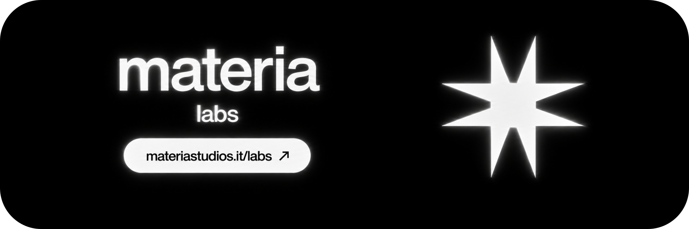

<h1 align="right">Jacopo Tonti</h1>

### I'm Jacopo

I turn ideas into digital products, working across **product thinking, visual identity and interaction**. I use AI to build, test and keep refining what starts as a sketch. I'm drawn to interfaces with character: strong typography, motion that feels right, and small details that make the whole thing click.

 

<h3 align="center">A brighter way to read the news.</h3>

Currently building <strong>SOLARRR</strong>, bringing together product design, technology and real world problems

<a href="https://github.com/jacopotontii/solarrr">Explore SOLARRR ↗</a> &nbsp;·&nbsp; <a href="https://solarrr.app">Visit solarrr.app ↗</a>

 

<h3 align="center">Partner &amp; Head of Tech</h3>

At <strong>Materia Studios</strong>, I lead the technical direction, from early exploration to development.

<a href="https://materiastudios.it/labs">Explore Materia Labs ↗</a>

