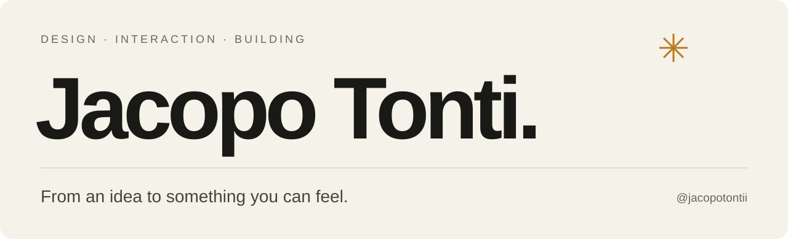
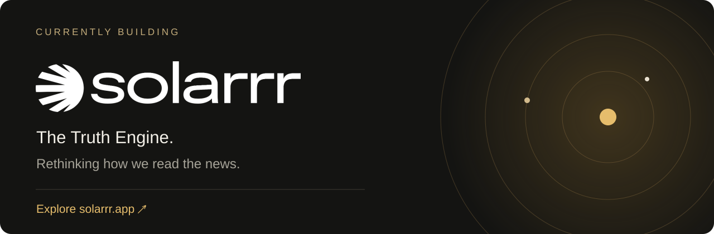

### Hey, I'm Jacopo.

I'm a designer who likes taking an idea all the way to something you can use. I work across **product thinking, visual identity and interaction**, using AI as part of the process to build and iterate.

I care about how a product feels: the type, the motion, the tiny details — and whether the whole thing actually makes sense.

**What draws me in**  
Interfaces with character. Thoughtful motion. Making complex things feel simple.

 

I'm currently working on **Solarrr**, a project exploring a clearer way to read the news. It's where I'm putting that mix of design, technology and attention to detail into practice.

**[Explore Solarrr ↗](https://solarrr.app)**
