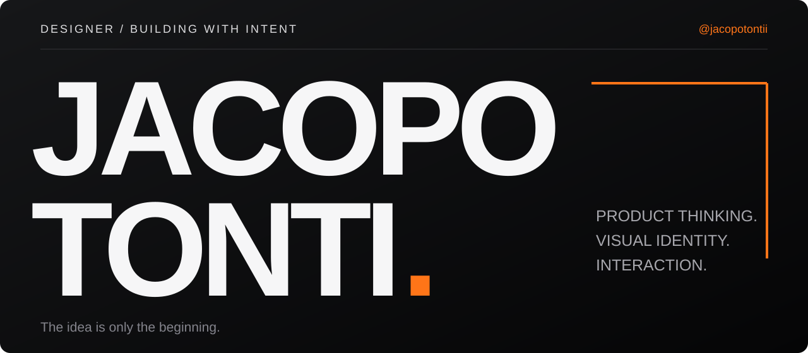

### Hey, I'm Jacopo.

I turn ideas into digital products, working across **product thinking, visual identity and interaction**. I use AI to build, test and keep refining what starts as a sketch.

I'm drawn to interfaces with character: strong typography, motion that feels right, and small details that make the whole thing click. For me, the work isn't finished at the mockup — I want to see it working.

 

I'm currently working on **Solarrr**, exploring a clearer way to read the news — and putting that mix of design, technology and attention to detail into practice.

[Visit solarrr.app ↗](https://solarrr.app)
